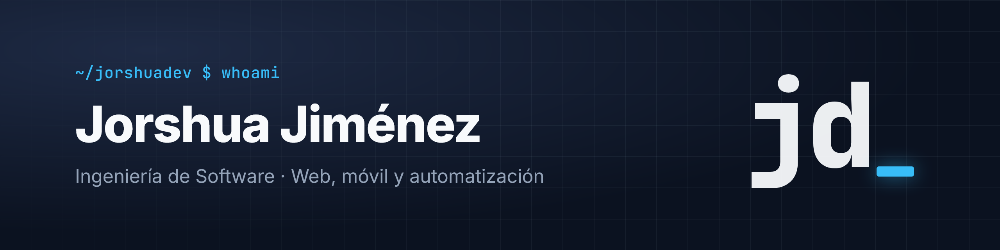

  

### Hola, soy Jorshua 👋

Estudiante de **Ingeniería de Software** en la Universidad Tecnológica de Panamá. Me gusta construir
herramientas que se usan de verdad: apps web, apps móviles y automatizaciones que ahorran tiempo.

- 🔭 Ahora mismo: **Campus**, un asistente universitario con web local, CLI y app Android que se sincroniza sin nube.
- 🌱 Aprendiendo: desarrollo de videojuegos (Unity y Godot) y arquitectura de apps móviles.
- 🎥 También enseño: tutoriales de programación en YouTube (*Clave Tutoriales*).
- 🌐 Portafolio: **[portafolio-mocha-three.vercel.app](https://portafolio-mocha-three.vercel.app)**

---

### 🛠️ Tecnologías

**Lenguajes**

**Web y móvil**

**Datos y herramientas**

---

### 🚀 Proyectos destacados

| Proyecto | Qué es | Stack |
|---|---|---|
| **[GameVault](https://github.com/jorshuadev/CoilStore)** · [demo](https://coil-store.vercel.app) | Plataforma para descubrir y compartir juegos gratuitos para Windows y Android | TypeScript · Next.js |
| **[Portafolio](https://github.com/jorshuadev/Portafolio)** · [demo](https://portafolio-mocha-three.vercel.app) | Mi portafolio profesional | TypeScript · Next.js |
| **[Android Link Manager](https://github.com/jorshuadev/Android-Link-Manager)** | Conecta, controla y gestiona un Android desde la PC por ADB | App de escritorio · ADB |
| **[Ñeques vs Gansos](https://github.com/jorshuadev/NVG)** · [jugar](https://jorshuadev.github.io/NVG/) | Tower defense para navegador | HTML · JavaScript |
| **Campus** *(privado)* | Asistente universitario: horario, tareas, notas y Moodle; web local, CLI y app Android con sincronización | Python · Java · SQLite |

---

  
  

